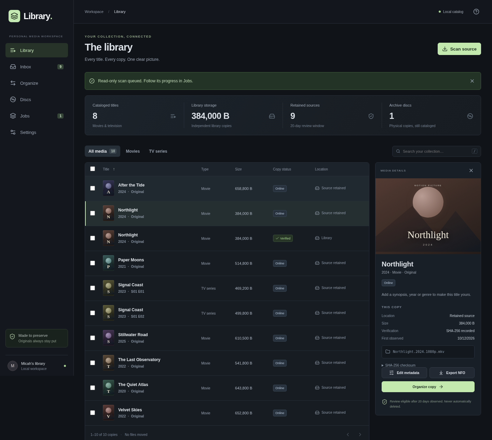
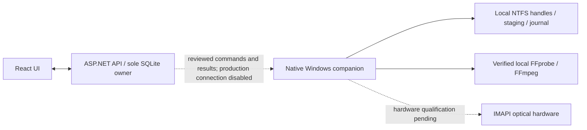

# Library

A local media catalog and preservation workspace for movies and television. React + TypeScript, ASP.NET Core, SQLite. The Windows architecture separates the Docker web/API/catalog from a native companion that owns local media I/O.

**Early implementation with synthetic qualification; not a production release.** The navigation areas connect to working APIs. Default Windows Compose runs the catalog, UI and imported media/preset review with media jobs paused. Native processing has passed local synthetic tests but is not connected to production jobs. Hardware burning, live torrent clients and Plex/Jellyfin servers have not been qualified.



## Implemented

- **Media review:** bounded read-only FFprobe inspection, unverified probe-JSON import, HandBrake preset previews and explicit language/role review. English and original-language audio stay copy-only; confirmed commentary is excluded and accessibility audio retained. See [media inspection and limits](docs/media-inspection.md).
- **Bounded media samples:** disabled-by-default 1-30 second samples from reviewed SDR H.264 inputs, using stream copy or fixed x265 CRF 22/Slow/8-bit video compression with audio/subtitle copy. Immutable derived-asset lineage, explicit stream maps, frame/packet/decode/hash validation and recovery preserve originals. Native activation currently accepts only an explicit synthetic-fixture hash allowlist. Samples cannot become complete library or archive copies. See [processing scope](docs/media-processing.md).
- **Windows execution foundation:** shared policy/validators and command/result contract; native NTFS staging, no-overwrite publication and recovery; and an actual FFmpeg/FFprobe adapter using pinned file handles. Windows Job Objects enforce memory/CPU/process limits and terminate child processes on cancellation, timeout or owner exit. Synthetic remux and x265 samples passed, including 1080p. Production processing and persistent pairing remain disabled. The earlier Linux media-transfer experiment is retained as historical evidence, not the Windows execution path. [Architecture checklist](docs/native-adapter.md).

- **Library / Inbox:** paginated catalog, filtering, keyboard search, artwork placeholders, resizable inspector, read-only incremental scans. Separate title, edition/episode, asset and physical-copy records. Missing files remain cataloged as offline.
- **Organize:** two panes, drag/drop or keyboard-accessible selection to stage a preview; approve independent copies with Plex-compatible paths. Sources and sidecars remain untouched. SHA-256 source-stream hash is compared with destination read-back before and after publication; catalog evidence is bound to the verified file identity. No overwrite, hardlink or deletion operations.
- **Integrations:** version-aware read-only qBittorrent adapter, per-file completion, explicit source-path mapping and copy-time readiness rechecks; disabled and synthetic modes. No live client has been used.
- **Metadata:** reviewable synthetic provider matches, bulk leave/set/clear changes, manual locks, optimistic revisions, old/new field and proposed-path previews. NFO import preview and export can preserve unknown XML fields when the original NFO is supplied. DTDs and external entities are prohibited.
- **Discs:** immutable backup sets and manifests, permanent handwriting-friendly labels, searchable attempt history and distinct replacement discs. Bounded exact-size optimization supports fill-one and minimize-disc objectives, reports whether optimality was proved, and keeps selected sidecars with their media. Season scopes declare expected/missing/excluded episodes and preserve whole-episode order across discs.
- **Windows companion:** native IMAPI UDF image creation and burning code, measured blank BD-R/DL capacity, full optical read-back, durable attempts and signed receipts. Manual BurnAware fallback uses the same frozen image. Compiles for Windows; hardware qualification is pending. See [companion setup and limits](docs/companion.md).
- **Preservation:** bounded optional audits, review-required failures and explicitly approved repair copies to new paths. No original media is overwritten. Offline restore targets a new directory and requires a startup reconciliation acknowledgement. [Audit/restore guide](docs/audits-restore.md).
- **Jobs / Settings:** SQLite durable journal, one active background file job, queue limit of 100, cancellation/retry, restart recovery, explicit path mappings, configurable retention review (20 days by default), JSON export and consistent SQLite backup.

The file-operation APIs above are implemented in the qualified Linux development path; the default Windows control plane keeps them paused until native production integration is complete. No open-source license has been selected. No credentials, personal media inventories or tracker URLs belong in this repository.

## Architecture



The worker owns Windows paths and media bytes; the API owns catalog writes, plans,
lineage and manifests. Media is not shuttled through an HTTP export service.
Existing source files, torrent payloads and hardlinks are never replaced by a
sample. An optimized variant is a new derived asset, not an identical physical
copy of its source. Archiving an optimized variant does not authorize source deletion.

## Windows catalog and review

With Docker Desktop available, from a fresh checkout and isolated catalog:

```powershell
docker compose up --build -d
```

Open **http://127.0.0.1:5080**. Default `compose.yaml` binds localhost and mounts
only its catalog volume. It needs no media path mappings. Media review can load
synthetic metadata and preview exported HandBrake presets or imported FFprobe
JSON; imports remain unverified. Scan/copy/processing jobs stay paused.

Do not point a development run at an existing live catalog or media library.
`compose.linux.yaml` is the separate legacy/development executor and requires
qualified Linux storage. The tested Docker Desktop Windows bind mount failed
atomic no-overwrite publication; the code intentionally has no overwrite fallback.
See [Windows setup and migration limits](docs/windows-docker.md).

## Native tooling and qualification

Native media execution uses explicit project-local paths, never a system PATH
lookup. Binaries, SDKs, fixtures and outputs are not committed. The qualified
build is **Gyan FFmpeg 9.0.2 Essentials**, linked by
[FFmpeg's download page](https://ffmpeg.org/download.html), installed with its
licenses under `.local/tools/ffmpeg/9.0.2-essentials/`. Verify the published ZIP
checksum and the pinned binary hashes in [tool qualification](docs/native-worker-qualification.md)
before executing it. Library does not download tools automatically.

Builds require .NET SDK **10.0.401** or a compatible patch; Node **24** builds the
client. An ignored `.dotnet/` installation can be invoked explicitly without
changing system PATH. Native harnesses require Windows NTFS and PowerShell hosted
on **.NET 10**; the tested harness loads the compiled assemblies into that host.
A standalone companion still needs a Windows .NET 10 runtime or a self-contained
publish. No background service, persistent worker credential or pairing is installed.

After building the companion test assembly and installing/verifying those tools,
run synthetic qualification from the repository root:

```powershell
dotnet build companion/Library.Companion.Tests -c Release
New-Item -ItemType Directory -Force .local/native-fixtures | Out-Null
./scripts/qualify-native-adapter.ps1 `
  -TestRoot "$PWD/.local/native-fixtures" `
  -TestAssembly "$PWD/companion/Library.Companion.Tests/bin/Release/net10.0/Library.Companion.Tests.dll" `
  -ToolsRoot "$PWD/.local/tools/ffmpeg/9.0.2-essentials"
```

The harness creates invented media, tests bounded native processing and failure
paths, and retains evidence. It does not read a media library or enable transport.
The temporary protocol qualification grant is cleared and its route is disabled
by default. See [native adapter scope and remaining gates](docs/native-adapter.md).

## Try locally with synthetic data

Prerequisites: **Linux**, .NET SDK **10.0.401** or a compatible patch, Node **24**, Python **3.11+** for restore validation. This development executor uses Linux filesystem primitives. Use isolated Linux-backed fixture roots for operations that publish files; a Windows-mounted WSL directory is not an equivalent storage qualification.

```sh
python3 scripts/synthetic-fixtures.py
npm --prefix client ci
# Terminal 1
scripts/run-api.sh
# Terminal 2
npm --prefix client run dev
```

Open **http://127.0.0.1:5173** and select **Scan source**. The fixture files are small text payloads with media extensions, not playable movies. Their invented titles and paths can be shared publicly. Runtime data stays in ignored `.local/`.

If `dotnet` is installed outside PATH, use `DOTNET=/absolute/path/to/dotnet scripts/run-api.sh`. A development-only proxy translates the UI origin to the loopback API origin; production serves the UI from the same ASP.NET host.

## Validate

```sh
dotnet test tests/Library.Tests -c Release
dotnet test companion/Library.Companion.Tests -c Release
npm --prefix client run test:media
npm --prefix client run build
# With the synthetic API and UI already running:
cd client
npx playwright install chromium
npm run test:e2e
# Or use an existing browser:
CHROMIUM_PATH=/usr/bin/chromium npm run test:e2e
```

The browser test performs real operations on the synthetic fixture roots. Use a dedicated fixture workspace. See [validation evidence](docs/validation.md), [architecture and safety boundaries](docs/architecture.md), [native Windows adapter qualification](docs/native-adapter.md) and [interoperability references](docs/references.md).

Latest local verification: **156 backend, 73 companion and 17 client-policy tests**,
the client build, and the bounded Windows header/render/probe checks described
below. Earlier native qualification passed **15 lifecycle** and **eight
resource/lifetime scenario groups**, Windows x64 publish and service image build.
The unchanged heavy native suite was not repeated for the latest evidence/helper
change. CI runs browser workflows and Windows compilation on each pushed commit;
local counts are not a CI claim.

The native 1080p synthetic encode preserved 48 frames, timing and dimensions plus
copied audio/subtitle packets, using 549 MiB peak committed memory under the 1 GiB
cap. Its video payload decreased 49.29%; that is fixture evidence, not a prediction
of movie compression or a perceptual-quality verdict.

## Gates before production media use

- Persistent pairing, production receipt integration and live catalog migration
  are not enabled. SQLite remains API-owned.
- Production native processing is synthetic-only. **Unknown source color range
  still blocks production encoding.** A separately approved Godzilla test used
  a source/window-bound H.264 default interpretation after checking active SPS/PPS
  references. Its 12-second encode retained 288 frames and copied Japanese audio
  plus both English PGS event streams. Reconciled technical evidence passed after
  resolving incomplete source subtitle metadata; no worker receipt or retained
  output was produced. Video payload fell 86.99% in this segment, with visual
  quality, whole-film savings and device playback still unassessed. No blanket
  range fallback was added. See [results and qualification limits](docs/color-and-pgs-qualification.md).
- **Silo processing remains blocked.** A read-only interval contains both Dolby
  Vision profile 8 and HDR10+ frame metadata. Preserving both needs a qualified
  path; an SDR preset or Dolby Vision option alone is insufficient. See
  [HDR preservation feasibility](docs/hdr-preservation-feasibility.md).
- Bounded samples use streaming MKV output and measured packet duration. Full-title
  finalized muxing, Plex client/audio-chain compatibility and optical read-back
  still need separate qualification.
- English and confirmed foreign-original audio stay copy-only; commentary exclusion
  must be confirmed. Accessibility audio and English regular/forced/SDH subtitles
  remain distinct. Ambiguous tags/roles block processing for review.

## Current limits

This is a reviewable initial implementation, not a production release. Filename inference is deliberately conservative and needs review. A read-only qBittorrent adapter and configuration UI are implemented with mocked contracts, but have not contacted a live client. Metadata matching uses explicitly synthetic responses; live TMDB lookup is unconfigured. There is no artwork download, FileBot dependency or automatic source cleanup. The Windows companion and IMAPI code are compiled and simulated, not qualified on an actual drive. See [integration states and setup](docs/integrations.md). The retention clock starts when a source is first observed, not at torrent completion. NFO sidecars are downloaded/exported, never rewritten in torrent directories. Existing library files can be scanned, but currently become eligible for disc planning only after a verified independent-copy job; bounded samples cannot be promoted. Full-scale 20-30 TB performance remains untested. The Linux executor remains blocked from publishing to the tested Docker Desktop Windows bind mount. The native Windows executor has passed synthetic NTFS processing, resource-control and recovery qualification; production activation remains disabled.
