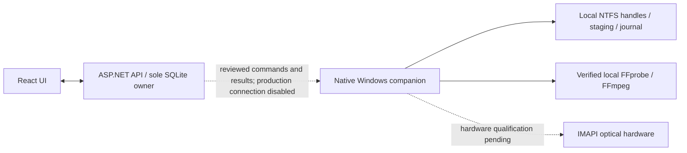

# Library

A local media catalog and preservation workspace for movies and television. React + TypeScript, ASP.NET Core, SQLite. The Windows architecture separates the Docker web/API/catalog from a native companion that owns local media I/O.

**Early implementation with bounded local qualification; not a production release.** The navigation areas connect to working APIs. Default Windows Compose runs the catalog, UI and imported media/preset review with media jobs paused. Native processing has passed synthetic and explicitly reviewed short-sample tests but is not connected to production jobs. Hardware burning, live torrent clients and Plex/Jellyfin servers have not been qualified.


## Implemented

- **Media review:** bounded read-only FFprobe inspection, unverified probe-JSON import, HandBrake preset previews and explicit language/role review. English and original-language audio stay copy-only; confirmed commentary is excluded and accessibility audio retained. See [media inspection and limits](docs/media-inspection.md).
- **Bounded media samples:** disabled-by-default 1-30 second samples from reviewed SDR H.264 inputs, using stream copy or fixed x265 CRF 22/Slow/8-bit video compression with audio/subtitle copy. Immutable derived-asset lineage, explicit stream maps, frame/packet/decode/hash validation and recovery preserve originals. Native activation currently accepts only an explicit synthetic-fixture hash allowlist. Samples cannot become complete library or archive copies. See [processing scope](docs/media-processing.md).
- **Windows execution foundation:** shared policy/validators and command/result contract; native NTFS staging, no-overwrite publication and recovery; and an actual FFmpeg/FFprobe adapter using pinned file handles. Windows Job Objects enforce memory/CPU/process limits and terminate child processes on cancellation, timeout or owner exit. Synthetic remux and x265 samples passed, including 1080p. Production processing and persistent pairing remain disabled. The earlier Linux media-transfer experiment is retained as historical evidence, not the Windows execution path. [Architecture checklist](docs/native-adapter.md).

- **Library / Inbox:** paginated catalog, filtering, keyboard search, artwork placeholders, resizable inspector, read-only incremental scans. Separate title, edition/episode, asset and physical-copy records. Missing files remain cataloged as offline.
- **Organize:** two panes, drag/drop or keyboard-accessible selection to stage a preview; approve independent copies with Plex-compatible paths. Sources and sidecars remain untouched. SHA-256 source-stream hash is compared with destination read-back before and after publication; catalog evidence is bound to the verified file identity. No overwrite, hardlink or deletion operations.
- **Integrations:** version-aware read-only qBittorrent adapter, per-file completion, explicit source-path mapping and copy-time readiness rechecks; disabled and synthetic modes. No live client has been used.
- **Metadata:** reviewable synthetic provider matches, bulk leave/set/clear changes, manual locks, optimistic revisions, old/new field and proposed-path previews. NFO import preview and export can preserve unknown XML fields when the original NFO is supplied. DTDs and external entities are prohibited.
- **Discs:** immutable backup sets and manifests, permanent handwriting-friendly labels, searchable attempt history and distinct replacement discs. Bounded exact-size optimization supports fill-one and minimize-disc objectives, reports whether optimality was proved, and keeps selected sidecars with their media. Season scopes declare expected/missing/excluded episodes and preserve whole-episode order across discs.
- **Windows companion:** native IMAPI UDF image creation and burning code, measured blank BD-R/DL capacity, full optical read-back, durable attempts and signed receipts. Manual BurnAware fallback uses the same frozen image. Compiles for Windows; hardware qualification is pending. See [companion setup and limits](docs/companion.md).
- **Preservation:** bounded optional audits, review-required failures and explicitly approved repair copies to new paths. No original media is overwritten. Offline restore targets a new directory and requires a startup reconciliation acknowledgement. [Audit/restore guide](docs/audits-restore.md).
- **Jobs / Settings:** SQLite durable journal, one active background file job, queue limit of 100, cancellation/retry, restart recovery, explicit path mappings, configurable retention review (20 days by default), JSON export and consistent SQLite backup.

The file-operation APIs above are implemented in the qualified Linux development path; the default Windows control plane keeps them paused until native production integration is complete. No open-source license has been selected. No credentials, personal media inventories or tracker URLs belong in this repository.

## Architecture



The worker owns Windows paths and media bytes; the API owns catalog writes, plans,
lineage and manifests. Media is not shuttled through an HTTP export service.
Existing source files, torrent payloads and hardlinks are never replaced by a
sample. An optimized variant is a new derived asset, not an identical physical
copy of its source. Archiving an optimized variant does not authorize source deletion.

## Choose a setup path

These instructions describe the implementation verified at `afffe2076d39ad843006a2da32c58bde73d1a01f`
(2026-10-25). The feature branch is still under development.

| Goal | Follow |
| --- | --- |
| Open the Windows UI safely, review presets and track policies | [Fresh Windows/Docker setup](#fresh-windowsdocker-setup) |
| Develop the API/UI and run the full automated suite | [Linux fixture workspace](#linux-fixture-workspace-and-automated-tests) |
| Test native NTFS publication and synthetic archive restoration | [Native Windows qualification](#native-windows-qualification) |
| Use Micah's existing checkout, tools and retained RF20 file | [Existing Wintermute workspace](#existing-wintermute-workspace) |
| Listen, select subtitles, seek and assess motion/Plex playback | [Human playback checks](#human-playback-checks) |

Do not use an existing live catalog or media library for these development steps.
The Windows review app and the Linux fixture API both use port 5080: run one at a
time. Production processing, persistent pairing, Silo processing and bulk encodes
stay disabled. Nothing below calls a burn command or replaces original media.

### Prerequisites

| Path | Requirements |
| --- | --- |
| Windows review app | Git with repository access; Docker Desktop running **Linux containers** with Compose v2; PowerShell; a browser. The Docker build downloads its own build/runtime dependencies; host Node/.NET/FFmpeg are unnecessary for this path. |
| Full automated tests | Linux or a WSL Linux filesystem, Git, Bash, .NET SDK **10.0.401** or a compatible patch selected by [global.json](global.json), Node **24** with npm, Python **3.11+**, and Chromium/Playwright dependencies. Use a fresh fixture checkout on Linux storage, not `/mnt/c` for file-publication tests. |
| Native qualification | Local Windows **NTFS**, the compiled companion test assembly and PowerShell hosted on **.NET 10**. Building locally also needs the .NET 10 SDK. FFmpeg is required only for the optional media-adapter tests. |
| Human playback | An existing player capable of HEVC video, DTS-HD MA audio and embedded PGS subtitles; an existing Plex setup for device checks. A player refusing a codec is a recorded compatibility result, not permission to convert the file. |

Tools, media, SDK installations and `.local/` evidence are not in Git. A fresh
clone does not include Wintermute's binaries or Godzilla sample.

## Fresh Windows/Docker setup

1. **Clone into a new directory.** `C:\Code\Library` below is an example, not an
   existing installation path. If you already have the checkout, use that path
   and preserve its changes instead of cloning over it.

   ```powershell
   New-Item -ItemType Directory -Force C:\Code | Out-Null
   git clone --branch feat/library-foundation https://github.com/sola-palantir/Library.git C:\Code\Library
   Set-Location C:\Code\Library
   git status --short
   docker version
   docker compose version
   ```

2. **Review the safe configuration.** Use an unused Compose project name for a
   new isolated catalog; these examples use `library-review`. Reuse that same
   name on every subsequent command for this instance.

   ```powershell
   docker compose -p library-review -f compose.yaml config
   ```

   [compose.yaml](compose.yaml) selects `Library__ExecutionBackend: windows-worker`,
   stores the catalog at `/data` in its project-scoped named volume, and binds
   `127.0.0.1:5080` to container port `8080`. All source/library/staging
   `ContainerPath` and `WindowsPath` values are empty. There are **no media mounts**
   and no enabled worker connection. No `.env` file or Windows media-path mapping
   is needed. `.env.example` belongs to the separate legacy Linux configuration;
   do not use it to enable Windows media operations.

3. **Build and start this isolated review app.** The first build needs registry
   and dependency-download access. These commands start only the named test
   instance; they do not install or pair a Windows worker.

   ```powershell
   docker compose -p library-review -f compose.yaml up --build -d
   docker compose -p library-review -f compose.yaml ps
   Invoke-RestMethod http://127.0.0.1:5080/api/health
   Invoke-RestMethod http://127.0.0.1:5080/api/execution
   ```

   Open **http://127.0.0.1:5080**. Health should report `status: ok`; execution
   should identify `windows-worker` with local jobs paused. A fresh catalog is
   empty, which is expected in this mode. Allow the API to finish starting; if
   the first health request is refused, inspect the logs and repeat that request.

4. **Try review without media access.** Open **Media review** → **Load synthetic
   example**. Enter `jpn` as the original language and review the unknown track's
   language/role. Import an exported HandBrake JSON file for a preset preview.
   English and confirmed original audio stay copy-only; commentary is excluded,
   accessibility audio retained, and English regular/forced/SDH subtitles kept
   separate. Imported FFprobe JSON remains unverified. These are previews, not
   processing approval. See [the review walkthrough](docs/media-inspection.md).

5. **Inspect logs or stop your instance when finished.** `down` below retains its
   catalog volume. Do not add `--volumes`/`-v`, run volume-pruning commands, or reuse
   a live catalog as a test reset.

   ```powershell
   docker compose -p library-review -f compose.yaml logs --tail 100 library
   docker compose -p library-review -f compose.yaml down
   ```

See [Windows configuration and migration limits](docs/windows-docker.md).
`compose.linux.yaml` is a separate development executor requiring qualified Linux
storage; it is not a workaround for paused Windows media jobs.

## Linux fixture workspace and automated tests

This path enables the Linux **development** executor against invented data only.
It is the environment used for the full API/browser suite, not the Windows
review-only Compose app. In WSL, use a directory in the Linux filesystem such as
`~/src/library-fixtures`, not `/mnt/c/Codex/Library`.

1. **Create a separate fixture checkout and restore dependencies.** Run in Bash;
   choose another new directory if the example already exists.

   ```sh
   mkdir -p ~/src
   git clone --branch feat/library-foundation https://github.com/sola-palantir/Library.git ~/src/library-fixtures
   cd ~/src/library-fixtures
   dotnet --version
   node --version
   python3 --version
   npm --prefix client ci
   dotnet restore tests/Library.Tests
   dotnet restore companion/Library.Companion.Tests
   dotnet restore tests/Library.Qualification
   ```

2. **Generate the invented fixture workspace.** This creates `.local/source`,
   `library`, `staging`, `disc` and `data`, plus `.local/config.json`. The script
   rewrites that configuration, so use this dedicated checkout, not a configured
   live workspace. Files with `.mkv`/`.mp4` extensions contain tiny text payloads;
   they are not playable movies.

   ```sh
   python3 scripts/synthetic-fixtures.py
   ```

   The generated `Library.DataPath` and each root's `ContainerPath` point inside
   this checkout's `.local/`. `WindowsPath` values such as
   `X:\LibraryFixture\source` are synthetic labels, not real mounted drives.
   [run-api.sh](scripts/run-api.sh) loads this exact config through `LIBRARY_CONFIG`.

3. **Run fast tests/builds from the checkout root.** Tests use isolated fixtures
   and temporary databases; they need neither the supplied films nor a burner.

   ```sh
   dotnet test tests/Library.Tests -c Release
   dotnet test companion/Library.Companion.Tests -c Release
   dotnet build tests/Library.Qualification -c Release
   dotnet publish companion/Library.Companion -c Release -r win-x64 --self-contained false
   npm --prefix client run test:media
   npm --prefix client run build
   ```

   Cross-publishing the companion checks compilation; it does not execute native
   Windows operations, pair anything or qualify optical hardware.

4. **Start the fixture API and UI in two terminals**, both in this checkout.
   First stop your own Docker review instance if it is occupying port 5080.

   Terminal A:

   ```sh
   scripts/run-api.sh
   ```

   Terminal B:

   ```sh
   npm --prefix client run dev
   ```

   For a project-local **Linux** SDK, Terminal A can instead use
   `DOTNET="$PWD/.dotnet/dotnet" scripts/run-api.sh` when that binary exists.
   Open **http://127.0.0.1:5173**, then **Scan source** to see invented titles.
   Vite proxies `/api` to port 5080; keep the documented `127.0.0.1` origins.

5. **Run browser tests from a third terminal.** Verify both servers first:

   ```sh
   curl -fsS http://127.0.0.1:5080/api/health
   curl -fsS http://127.0.0.1:5173/ > /dev/null
   cd client
   npx playwright install --with-deps chromium
   npm run test:e2e
   ```

   The Playwright installation step downloads a browser and may install OS
   dependencies in this development environment. If compatible Chromium is
   already installed, skip it and run
   `CHROMIUM_PATH=/usr/bin/chromium npm run test:e2e`, substituting its actual
   executable path. `LIBRARY_BASE_URL` can override the test URL for a separately
   prepared synthetic server; never point this suite at a live catalog or the
   Windows review-only instance. Tests make real fixture copies and archive plans
   and write screenshots under `docs/screenshots/`; review Git changes afterward.

6. **Stop the two development servers with Ctrl+C** in their terminals. Keep
   their fixture data/evidence separate from media. Current implementation CI
   passes **164 backend, 86 companion, 17 client-policy and 12 browser tests**.
   See [CI commands](.github/workflows/ci.yml) and [validation evidence](docs/validation.md).

## Native Windows qualification

These are manually invoked synthetic tests, not a service installation. No
listener, pairing credential, live catalog or optical device is required.

1. In Windows PowerShell, check the runtime with
   `[Runtime.InteropServices.RuntimeInformation]::FrameworkDescription`.
   The harness requires **.NET 10** in the PowerShell host; installing a .NET SDK
   alone does not change the runtime of an already installed PowerShell.
2. With the Windows .NET 10 SDK available, build the test assembly from the
   checkout root: `dotnet build companion/Library.Companion.Tests -c Release`.
   Alternatively use the existing Linux build route described under Wintermute;
   the harness itself must still execute on Windows.
3. Run publication and archive-restore fixtures. Each invocation creates a new
   directory of invented bytes and retains its evidence. These two modes do not
   need FFmpeg and do not read the Godzilla/Silo files.

   ```powershell
   New-Item -ItemType Directory -Force .local/native-fixtures | Out-Null
   $testAssembly = Join-Path $PWD 'companion/Library.Companion.Tests/bin/Release/net10.0/Library.Companion.Tests.dll'
   ./scripts/qualify-offline-workflow.ps1 -TestRoot "$PWD/.local/native-fixtures" -CompanionTestAssembly $testAssembly -Mode Publication
   ./scripts/qualify-offline-workflow.ps1 -TestRoot "$PWD/.local/native-fixtures" -CompanionTestAssembly $testAssembly -Mode ArchiveRestore
   ```

4. **Optional media-adapter testing needs separately prepared tools.** The pinned
   build is Gyan **FFmpeg 9.0.2 Essentials**, linked by
   [FFmpeg's download page](https://ffmpeg.org/download.html). Follow
   [the recorded ZIP/binary checksum and layout](docs/native-worker-qualification.md#installed-tools)
   before executing it. Preserve its licenses/docs under
   `.local/tools/ffmpeg/9.0.2-essentials/`; expected executables are
   `bin/ffmpeg.exe` and `bin/ffprobe.exe`. Do not substitute an unverified newer
   binary or change system PATH. Library has no automatic tool installer.

   After preparing that exact layout, this optional command creates and tests
   **invented 1080p media**, one job at a time:

   ```powershell
   ./scripts/qualify-native-adapter.ps1 `
     -TestRoot "$PWD/.local/native-fixtures" `
     -TestAssembly $testAssembly `
     -ToolsRoot "$PWD/.local/tools/ffmpeg/9.0.2-essentials" `
     -Mode Media1080
   ```

   It is unnecessary for opening the retained RF20 file. Other test modes and
   resource/failure checks are documented in [native adapter qualification](docs/native-adapter.md).
   Do not run transport/pairing or physical-burn commands as part of this guide.

## Existing Wintermute workspace

These paths were verified on **Micah's Wintermute**, not created by a fresh clone.
Use the existing checkout without overwriting it or regenerating its `.local/config.json`.

| Item | Existing path |
| --- | --- |
| Git checkout | `C:\Codex\Library\source` |
| Supplied input copies | `C:\Codex\Library\Test Files` |
| Original exported presets | `C:\Codex\Library\1080p-preset.json`, `C:\Codex\Library\4k-preset.json` |
| Project-local Linux SDK | `C:\Codex\Library\source\.dotnet\dotnet` — Linux executable, not `dotnet.exe` |
| Verified native tool directory | `C:\Codex\Library\source\.local\tools\ffmpeg\9.0.2-essentials` |
| Retained sample | `C:\Codex\Library\source\.local\playback-qualification\Library Qualification - Godzilla RF20 (8-second sample).mkv` |

1. Open the existing checkout and inspect its state:

   ```powershell
   Set-Location C:\Codex\Library\source
   git status --short
   ```

   The Windows review app can be started using the `library-review` Compose steps
   above, provided that is an unused/known isolated project and port 5080 is free.
   This does not start an existing production deployment.
2. If rebuilding the native harness using the existing Linux SDK is necessary,
   this previously used WSL command builds managed assemblies only:

   ```powershell
   wsl -d Ubuntu -- bash -lc 'cd /mnt/c/Codex/Library/source && DOTNET_CLI_HOME=$PWD/.local/dotnet-home NUGET_PACKAGES=$PWD/.local/nuget .dotnet/dotnet build companion/Library.Companion.Tests -c Release --no-restore /p:UseAppHost=false'
   ```

   It assumes Wintermute's existing Ubuntu distribution and restored dependencies.
   It does not make `/mnt/c` a qualified Linux media-publication location. Use a
   separate Linux fixture workspace for the full API/browser walkthrough.
3. Verify and open the already accepted sample; **do not re-encode it**:

   ```powershell
   $sample = 'C:\Codex\Library\source\.local\playback-qualification\Library Qualification - Godzilla RF20 (8-second sample).mkv'
   if (-not (Test-Path -LiteralPath $sample -PathType Leaf)) { throw 'Retained sample is unavailable; do not regenerate it automatically.' }
   if ((Get-FileHash -LiteralPath $sample -Algorithm SHA256).Hash.ToLowerInvariant() -ne 'edfa73c2771d094cfe28c58ff98b845db3ea8ae2f295b96a983005614da479d1') { throw 'Sample hash differs; stop and review.' }
   Get-Item -LiteralPath $sample | Select-Object Name, Length
   Invoke-Item -LiteralPath $sample
   ```

   Expected size: **9,826,780 bytes**. `Invoke-Item` opens the associated player;
   it does not establish codec support. The file has eight seconds of video and
   **8.832 seconds of packet-measured duration** including audio preroll. Its
   streaming MKV does not promise a finalized duration/cue index. Keep only this
   one generated output per source, preserve old residuals, inputs and saved
   presets, and continue with the human checks below.

## Human playback checks

These checks are **not yet passed**. Automated decode, hashes, subtitle images
and seek-frame comparisons do not establish heard audio or viewed motion.

1. **Local Windows playback:** use the retained file in an existing capable
   player. Record the player/version and whether playback starts. Select Japanese
   (`jpn`) **DTS-HD MA** audio. Listen for continuity and apparent sync; record
   anything this short clip cannot establish. Do not convert the audio.
2. **Subtitles:** replay from the beginning with the English regular PGS track,
   then with **English (SDH)**. Both contain cues roughly 2–6 seconds into the
   file, with different cue splits. Check placement, clipping and timing, and
   that changing the selection actually changes tracks. Empty subtitles near the
   end alone are not a failure; the clip has no later cue there.
3. **Seeking and motion:** seek to about **7 s → 1 s → 4 s**, then replay normally.
   Check recovery of picture/audio/subtitles, the dim walking shot and grain/fine
   foliage detail. Record missing duration controls or seeking failures rather
   than remuxing the file. The sample is too short for whole-film quality claims;
   comparing static crops is not a substitute for watching it move.
4. **Existing Plex only:** proceed only when this same retained file is available
   through an already approved test-library path. Library does not add it to Plex.
   If it is unavailable, mark Plex checks **not run**; arranging access is a
   separate reviewed step. Do not create a second media copy, change library or
   network/security settings, enable remote access, or use Plex Optimize for this
   test. Keep current playback-quality settings and record them.
5. Replay with subtitles off, English regular and English SDH on **Windows,
   iPad Pro, Apple TV 4K and Samsung Z Fold7**. In the existing server's
   [Dashboard / Now Playing](https://support.plex.tv/articles/200871837-status-and-dashboard/),
   record available video and audio playback details separately: **Direct Play,
   Direct Stream or Transcode**. Open the dashboard before starting this short
   clip and replay it if needed to capture the details. Record any subtitle burn-in/transcoding indication
   rather than assuming native PGS support. Plex's
   [Direct Play/Direct Stream explanation](https://support.plex.tv/articles/200250387-streaming-media-direct-play-and-direct-stream/)
   describes why client capability matters. Client menus vary; no universal
   direct-play result is promised. Record the Apple TV's TV/receiver/soundbar or
   headphone output chain as well.

Use one row per device and subtitle mode; record unavailable information as
unknown, not passed:

| Device + OS/client version | Server version; local/remote; quality setting | Audio + subtitle selection | Video mode / audio mode / subtitle handling | Heard audio; seek; motion/grain result |
| --- | --- | --- | --- | --- |
| Not tested yet | — | — | — | — |

## Catalog, archive and recovery testing boundaries

| Check | How to exercise it | What it proves / does not prove |
| --- | --- | --- |
| Catalog/copy/archive UI | Linux fixture API + browser suite above | Real operations on invented payloads, not supplied films or Windows production jobs |
| Native restoration | `qualify-offline-workflow.ps1 -Mode ArchiveRestore` above | Distinct byte-identical synthetic restore file and failure/recovery guards on the same device; no optical or independent-hardware claim |
| Catalog restore | [Offline restore procedure](docs/audits-restore.md) on an exported **test** backup and new destination | Catalog/history recovery and startup review gate; no media restoration or service activation |
| Retained RF20 workflow | [Recorded end-to-end qualification](docs/end-to-end-qualification.md) | Reviewed native file, isolated catalog lineage/manifest and full read-back; production sample archive eligibility still refused |

The standalone `tests/Library.Qualification` runner is an offline test tool with
explicit checkpoint/manifest inputs, not a UI import or production receipt route.
Detailed commands and the same-host restore evidence are in
[the qualification record](docs/end-to-end-qualification.md#unattended-recovery-follow-up).
Do not erase restore markers, set an acknowledgement just to bypass review, or
start a service on an unreviewed restored catalog. No burn command is part of
these instructions; IMAPI/BD-R/BurnAware hardware qualification remains pending.

## Troubleshooting setup and tests

| Symptom | Check / supported response |
| --- | --- |
| Port 5080 or 5173 already in use | Check your named Compose project's `ps`/logs and your own dev terminals. Run one setup path at a time; stop only the test instance you started. Do not kill or reconfigure an unrelated service. |
| Windows app is empty or media jobs are paused | Expected with `windows-worker`, no media mounts and no paired worker. Use **Media review → Load synthetic example**; do not enable processing to make the preview work. |
| SDK missing, wrong runtime or assembly-load failure | Match `global.json`; use Linux for the API/fixture tests. Wintermute's `.dotnet/dotnet` is Linux-only. Native PowerShell needs a .NET 10 host; Linux ASP.NET runtime binaries cannot be loaded into Windows PowerShell. |
| `renameat2(RENAME_NOREPLACE)` / `EINVAL` | Windows-mounted Linux staging is unqualified. Use Linux-backed fixture storage for Linux tests and native NTFS harnesses for Windows. No overwrite fallback or mount change is prescribed. |
| Docker build or dependency/browser download fails | Preserve the reported error and check approved registry/network access. Do not disable TLS/security or silently substitute images/binaries. The app has not started until its health check succeeds. |
| Browser tests fail on origin or connection | API: `127.0.0.1:5080`; Vite: `127.0.0.1:5173`. Start both fixture servers and check health. Use the Vite proxy; do not weaken CORS to fix a mismatched origin. |
| Native sample timeout or memory refusal | The bounded native subprocess limit is **120 seconds**, **1 GiB aggregate committed memory**, **25% CPU hard cap**, two processes and bounded output/logs. Preserve evidence/owned partials; do not raise caps blindly or start a duplicate output. The earlier 12-second RF20 timeout was followed by one reviewed eight-second retry, not a general full-title capability. |
| Player cannot decode audio/subtitles or lacks reliable duration | Record the exact player/client and failed operation. The retained file is streaming MKV with DTS-HD MA/PGS; FFmpeg validation does not guarantee every client supports it. Do not replace tracks or modify the sample to manufacture a pass. |

Further context: [architecture and safety boundaries](docs/architecture.md),
[native adapter limits](docs/native-adapter.md), and [references](docs/references.md).

## Verification summary

Latest local verification: **164 backend and 86 companion tests**; the prior
unchanged client passed **17 client-policy tests** and its build. Native checks
include ten same-device synthetic archive-restore scenario groups and the Windows
header/render/probe checks described below. Earlier native qualification passed **15 lifecycle** and **eight
resource/lifetime scenario groups**, Windows x64 publish and service image build.
The unchanged heavy native suite was not repeated for the latest evidence/helper
change. CI runs browser workflows and Windows compilation on each pushed commit;
local counts are not a CI claim.

The native 1080p synthetic encode preserved 48 frames, timing and dimensions plus
copied audio/subtitle packets, using 549 MiB peak committed memory under the 1 GiB
cap. Its video payload decreased 49.29%; that is fixture evidence, not a prediction
of movie compression or a perceptual-quality verdict.

## Gates before production media use

- Persistent pairing, production receipt integration and live catalog migration
  are not enabled. SQLite remains API-owned.
- Production native processing is synthetic-only. **Unknown source color range
  still blocks production encoding.** A separately approved Godzilla test used
  a source/window-bound H.264 default interpretation after checking active SPS/PPS
  references. Its 12-second encode retained 288 frames and copied Japanese audio
  plus both English PGS event streams. A fresh sample stayed in RAM through full
  validation, whole-container hashing and matched frame/subtitle visual review,
  then received a local sample acceptance before disposal. Video payload fell
  86.99% in this segment, with visible grain and fine-texture loss. This is not
  quality parity, whole-film savings or device qualification. No worker/catalog
  receipt or published movie was created. No blanket
  range fallback was added. See [results and qualification limits](docs/color-and-pgs-qualification.md).
- A separately approved **RF20 comparison** changed only libx265 CRF 22 to 20 for
  that same 12-second segment. It passed the same technical checks. Total output
  was 14,867,032 bytes versus RF22's 11,237,343 (**32.3% larger**), with modestly
  better grain/fine texture in the inspected native crops. Motion was not viewed;
  this does not establish quality parity or device playback. The exported presets
  and production RF22 profile are unchanged. See [RF20 comparison](docs/color-and-pgs-qualification.md#rf20-versus-rf22-comparison---2026-10-25).
- A subsequent **offline RF20 workflow** retained one eight-second test file
  (9,826,780 bytes), verified copied Japanese audio/both English PGS tracks,
  native publication cancellation/restart, frame-exact seek results, isolated
  catalog lineage, a test archive manifest, catalog backup/reopen and full file
  read-back. This is a manually exercised qualification path; production sample
  archive eligibility remains refused. Actual motion, heard audio, Plex/device
  playback and independent media/optical restoration remain unrun. See
  [retained output, results and playback handoff](docs/end-to-end-qualification.md).
- The unattended follow-up qualified **synthetic archive-to-file restoration**
  with the original absent, corrupt-input refusal and interrupted recovery, plus
  the shipped catalog restore/startup-review gate on a separate durable test
  volume. It also fixed early rejection of manifest file/directory collisions.
  These are same-host tests; independent hardware/optical and real-media restore
  remain unqualified. The retained RF20 output was not copied or re-encoded.
- **Silo processing remains blocked.** A read-only interval contains both Dolby
  Vision profile 8 and HDR10+ frame metadata. Preserving both needs a qualified
  path; an SDR preset or Dolby Vision option alone is insufficient. See
  [HDR preservation feasibility](docs/hdr-preservation-feasibility.md).
- Bounded samples use streaming MKV output and measured packet duration. Full-title
  finalized muxing, Plex client/audio-chain compatibility and optical read-back
  still need separate qualification.
- English and confirmed foreign-original audio stay copy-only; commentary exclusion
  must be confirmed. Accessibility audio and English regular/forced/SDH subtitles
  remain distinct. Ambiguous tags/roles block processing for review.

## Current limits

This is a reviewable initial implementation, not a production release. Filename inference is deliberately conservative and needs review. A read-only qBittorrent adapter and configuration UI are implemented with mocked contracts, but have not contacted a live client. Metadata matching uses explicitly synthetic responses; live TMDB lookup is unconfigured. There is no artwork download, FileBot dependency or automatic source cleanup. The Windows companion and IMAPI code are compiled and simulated, not qualified on an actual drive. See [integration states and setup](docs/integrations.md). The retention clock starts when a source is first observed, not at torrent completion. NFO sidecars are downloaded/exported, never rewritten in torrent directories. Existing library files can be scanned, but currently become eligible for disc planning only after a verified independent-copy job; bounded samples cannot be promoted. Full-scale 20-30 TB performance remains untested. The Linux executor remains blocked from publishing to the tested Docker Desktop Windows bind mount. The native Windows executor has passed synthetic NTFS processing, resource-control and recovery qualification; production activation remains disabled.
