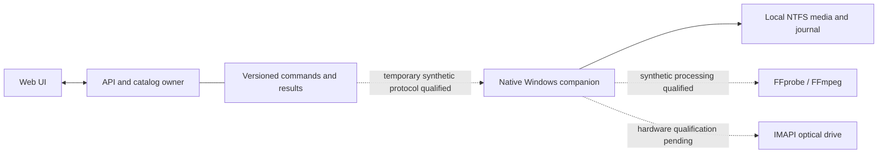

# Windows execution boundary

The Windows deployment has one catalog owner and one owner of local media I/O.
The ASP.NET API keeps SQLite, UI, metadata, track review, immutable plans,
derived-asset lineage and archive manifests. The native companion owns local
paths, source handles, FFmpeg/FFprobe, staging, validation and publication, with
optical hardware still requiring qualification. The connection carries job instructions and receipts,
not movie bytes. SQLite is never shared with the companion.



## Implemented boundary

- `shared/Library.Execution` has no ASP.NET, EF, network or Windows dependency.
  It contains the existing reviewed sample policy, exact profile reference,
  file observations, immutable command digest, stream/packet/frame validators and result matching. API schema
  configuration stays in `DerivedCatalog`; schema version and catalog records
  are unchanged by this refactor.
- `IMediaExecutor` separates inspection, execution and reconciliation. Commands
  contain root IDs and relative paths, never executable paths, shell commands,
  URLs or media bytes. A trusted processor receives pinned streams. The default
  native processor remains disabled. `NativeMediaProcessor` implements local
  remux/SDR sample encoding through the verified binaries, with activation limited
  to an explicit synthetic-fixture hash allowlist. No production job route enables it.
- `WindowsMediaWorker` resolves roots from its own configuration, freezes the
  reviewed command, checks source identity and SHA-256, and retains a read handle
  denying writes/deletion. A seeding hardlink may be read; neither name is changed.
- State, source and staging must be existing, separate local NTFS directories.
  Scope pins parent directories and rejects traversal/junctions/reparse points.
  Outputs require one link. UNC/NAS/FAT/exFAT are not qualified.
- A native exclusive state lock serializes work. Immutable intent records reserve
  one output per source; a different job or changed command cannot reuse it.
  Partial output is exclusively created and bounded to 256 MiB. The trusted
  worker has a five-minute deadline. Each native subprocess is created inside a
  Windows Job Object with a two-minute deadline, 1 GiB aggregate committed-memory
  limit, 25% CPU hard cap and two-process limit. The job is killed on cancellation,
  root exit or owner death. These are process-local controls, not system settings.
- Validation/hash checkpoints precede flush and native same-handle no-overwrite
  publication. Published files are reopened and rehashed before completion.
  Retry after a validated or published checkpoint reconciles that exact file
  without rerunning processing. An unvalidated partial, torn journal, collision,
  changed source or changed result is retained and blocks automatic retry.
  No cleanup operation or reservation-release mechanism was added.
- Synthetic validation is labeled `synthetic` and rejected by the production
  result matcher. Matching a digest is **not authentication**. A disabled-by-default
  qualification route accepts one offline-approved synthetic command/result with
  a job/plan-bound bearer grant lasting at most ten minutes. It cannot register
  catalog media. No production result-import route, persistent pairing, Windows
  listener or background service was created.

## Deployment state

`compose.yaml` now describes **Windows control-plane mode**. It has only the
catalog volume; there are no media mounts or media export service. This source
change has not been deployed. Startup rejects enabling Linux sample processing
or handoff in this mode. Linux job and audit schedulers are not started, storage
operations fail closed, and existing jobs remain unchanged. The UI explains that
media jobs are paused; imported reviews and preset previews remain usable.

`compose.linux.yaml` retains the Linux executor for qualified Linux storage and
development. Do not use it to bypass the observed Docker Desktop Windows bind
mount `renameat2(RENAME_NOREPLACE)` failure. The earlier Linux staging/handoff
experiment and its evidence are retained but are not the Windows execution path.

## Qualification and limits

Run the native lifecycle harness on Windows after compiling the test project:

```powershell
./scripts/qualify-windows-worker.ps1 -TestRoot C:/isolated/existing-fixtures `
  -TestAssembly ./companion/Library.Companion.Tests/bin/Release/net10.0/Library.Companion.Tests.dll
```

It uses the actual compiled native worker and creates only small invented files
in a fresh directory. It checks inspect/hash, publication/reopen, collision,
cancellation, exclusive worker/source/parent locks, command replay, one-source
reservation, interrupted journal, changed output and recovery on both sides of
publication. It also checks source/output hardlinks, root overlap, traversal and
junction refusal. It launches its own short-lived hidden PowerShell child, exits
that process at each validated/published checkpoint, and reconciles from a fresh
worker. All evidence is retained. Process-exit recovery does not establish
physical power-loss durability or optical hardware qualification.

The approved Gyan 9.0.2 Essentials FFmpeg/FFprobe binaries are now installed under
ignored `.local/tools/ffmpeg/9.0.2-essentials`, with their published ZIP checksum,
binary hashes and licenses retained. They are invoked by explicit paths; Windows
PATH is unchanged. The initial [binary/protocol qualification](native-worker-qualification.md)
is now followed by [native adapter qualification](native-adapter.md): actual
synthetic remuxing/encoding, packet/frame/decode validation and recovery. This
does not qualify real-title codecs, Plex clients or full-title processing.

System .NET hosts are still 6/8. Native DLL tests run inside the already-installed
PowerShell .NET 10 host. An independently launched companion will need a compatible
Windows .NET 10 runtime or self-contained publish; neither was installed here.

## Remaining migration gates

1. Qualify real-media codec combinations and any full-title container requirements
   before broadening synthetic-only activation. The local executor and its OS
   controls are implemented; real-media execution remains paused. The bounded
   stdout mux produces a streaming MKV, whose duration is measured from every A/V
   packet at EOF; seekable full-title mux finalization is not enabled.
2. Choose and approve production command/result access before enabling it. The
   temporary test used `127.0.0.1:5084`, one offline-approved job and a ten-minute
   token. Its grant is cleared and API stopped. It does not establish persistent
   pairing or authorize other jobs. The intended receiver remains this PC's
   Windows companion, with metadata commands/results and worker-owned roots.
   A concrete binding, identity, lifetime and persistence proposal is required
   before creating production access.
3. Wire authenticated results to the API's existing source lease, readiness
   recheck and transactional derived-asset registration. The worker must never
   write SQLite. Preserve pending old jobs and reconcile them explicitly; do not
   migrate or replay them automatically.
4. Qualify native scans/copies/archive staging and existing IMAPI through the
   same worker ownership boundary before enabling those production operations.
   Existing Linux implementations and optical simulation tests remain intact.

Godzilla's sparse PGS read-ahead remains a separate FFmpeg diagnosis. The 10-second
copy-only diagnostic read approximately 646 MB through 166 seconds of source to
reach a selected subtitle stream. The packet-window prototype has unit coverage
but has not been qualified with an actual encode. Moving to Windows is not a
demonstrated fix. Silo Dolby Vision processing remains blocked. Neither supplied
test title was changed during this refactor.

## Proposed connection setup requiring separate approval

This production setup is a proposal only. The completed temporary synthetic
qualification is separate and its grant is cleared.
The manually launched companion on this Windows PC would poll the existing
API's `127.0.0.1:5080` binding for commands and post receipts back on that same
connection. Windows would open no listening port. Payloads would contain job
IDs, root IDs, relative filenames, reviewed stream selections, observations,
hashes and validation results; **no movie bytes**. The API would authenticate
a newly paired worker credential and keep only its verifier. A worker-side
credential would persist under a separately approved private local state root.
This creates new persistent local access even though it does not expose a port
off-machine. Exact state/config destinations and credential lifecycle must be
approved before pairing; the synthetic-clip transfer approval does not cover it.
No background service or automatic startup is needed for initial qualification.
